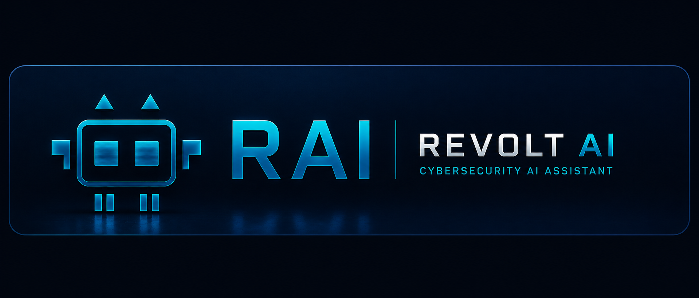

# RAI — Revolt AI

<div align="center">

 <p>
    <a align="center" href="" target="https://github.com/RevoltSecurities/RAI">
      
    </a>
  </p>


**The open-source AI security operator built for professionals.**

RAI works, builds, hacks, and assists — autonomously.  
It thinks like a security researcher, codes like an engineer,  
and operates like a professional red teamer. All in your terminal.

[](https://pypi.org/project/revolt-rai/)
[](https://www.python.org/)
[](https://github.com/RevoltSecurities/rai/releases)
[](https://github.com/RevoltSecurities/rai/commits/main)
[](LICENSE)
[](https://github.com/RevoltSecurities/RAI/pkgs/container/revolt-rai)

</div>

---

## What is RAI?

RAI is a terminal-native AI security assistant and autonomous agent that executes across the full cybersecurity spectrum — from initial recon to exploit development, SAST, threat modeling, bug bounty, VAPT, and SOC operations.

It is not a chatbot. It is an operator.

RAI orchestrates a team of specialized subagents in parallel, maintains memory across sessions, learns from every engagement, writes and executes structured plans with your approval, and builds its own tools when none exist. It reads code, writes exploits, probes APIs, maps attack surfaces, triages vulnerabilities, and documents findings — all autonomously, all in your terminal.

Whether you are a solo bug bounty hunter, a professional red teamer, or a security engineer automating your workflow — RAI adapts to how you work.

---

## What RAI Can Do

### Security Operations
- Map full attack surfaces — web, API, cloud, Kubernetes, Docker, Android, network
- Probe endpoints for OWASP Top 10, authentication bypass, IDOR, SSRF, injection, and more
- Research CVEs, pull exploit PoCs, cross-reference HackerOne prior art
- Generate Nuclei templates, IDOR enumerators, and custom fuzz scripts
- Write comprehensive pentest reports with findings, severity, and reproduction steps

### Secure Code Analysis
- Run static analysis with semgrep, bandit, gosec, and custom rules
- Detect secrets, hardcoded credentials, and insecure configurations
- Audit dependency trees for known CVEs
- Trace data flows from source to sink across entire codebases
- Suggest and implement remediation in-place

### Security Tooling & Automation
- Write exploit scripts and PoC builders from scratch
- Build custom security tools, scanners, and automation pipelines
- Create specialized AI subagents tailored to your workflow
- Extend itself with skills you define in plain Markdown
- Integrate with any external tool via MCP (Burp Suite, Nuclei, custom APIs)

### Engineering Assistance
- Architect security-aware systems and review designs for flaws
- Generate test suites, CI security gates, and hardening scripts
- Explain vulnerability classes, attack chains, and mitigations in depth
- Pair-program exploit development with full context awareness

---

## Unique Features

### Plan Mode — Structured Autonomous Execution

RAI doesn't just run — it plans. Before executing a complex engagement, RAI writes a structured multi-step plan with a title, description, and execution approach for every step. The plan is presented for your review and approval before a single action is taken.

```
Here RAI plan is ready:

About the Plan: Web application penetration test for api.example.com

1. Enumerate API Endpoints  ⬜
   * Map all exposed routes using OpenAPI spec and live probing.
   * 🔧 Load spec, verify with GET requests, use gobuster for undocumented routes.

2. Test Authentication  ⬜
   * Verify each endpoint enforces proper authentication.
   * 🔧 Create auth profiles (admin/user/unauth), compare responses for 401/403 vs 200.

3. Test for IDOR  ⬜
   * Probe object references across all user-scoped endpoints.
   * 🔧 Enumerate IDs, swap user tokens, record access control differences.
```

You can approve, reject, or send guidance — RAI adapts and continues. Every step is tracked live in the TUI. Blocked steps are flagged with reasons. Completed steps accumulate notes for the final report.

**Why this matters:** You always know what RAI is about to do. No black-box execution. No surprises.

---

### Self-Learning Memory Loop

RAI gets smarter with every engagement. When a plan completes, RAI automatically enters a self-learning phase — it reviews what happened, extracts key facts, methodology notes, blockers, and lessons learned, and writes them into its persistent memory.

On the next engagement, those memories are loaded into context. RAI remembers:

- **Target facts** — what was tested, what was found, what the architecture looks like
- **Methodology** — what worked, what didn't, which tools were effective
- **Blockers and workarounds** — WAF rules, rate limits, auth edge cases you discovered
- **Lessons learned** — patterns that generalize to future targets

This is not just conversation history. It is structured, agent-scoped memory that persists across sessions, across targets, and across time.

---

### Persistent Agent Memory

Every agent in RAI maintains its own memory store at `~/.rai/agents/<name>/memory/`. Memory is written at the end of each run, organized by scope:

- **Agent-scope** — methodology, preferred tools, approach patterns
- **User-scope** — your preferences, how you like to work, engagement conventions
- **Project-scope** — target-specific facts loaded when relevant

Memory is plain Markdown — human-readable, editable, and version-controllable.

---

### Human-in-the-Loop Tool Approval

Every tool call RAI makes can be reviewed before execution. In interactive mode, a beautiful approval panel shows you exactly what is about to run — the tool name, the arguments, the target — and asks you to approve, edit, or reject it.

Dangerous operations (file writes, shell commands, network requests) surface clearly. You stay in control at every step while RAI handles the complexity.

---

### Parallel Subagents — Autonomous Security Teams

RAI runs an entire team of specialized agents simultaneously. When you kick off a VAPT, RAI dispatches:

- `recon` — mapping the full attack surface in parallel
- `researcher` — hunting CVEs and HackerOne prior art
- `coder` — building exploit scripts and Nuclei templates
- `sast-analyzer` — scanning the codebase statically

All running in parallel. All reporting back as they complete. The main RAI agent synthesizes results and maintains the high-level strategy while the team works.

Launch tasks explicitly with subagent tools, or let RAI decide when to parallelize:

```
Subagent tool: launch "recon" against api.example.com
Subagent tool: launch "researcher" — CVE research for Struts 2.5
Subagent tool: launch "coder" — build IDOR enumerator for /api/users/{id}
[All three running concurrently]
```

---

### Background Runs

RAI can run multiple engagements simultaneously. Launch a task, send it to the background with `ctrl+b`, start another, and monitor all of them from the background runs panel. Each run has its own thread, its own memory, and its own execution context.

---

### Context Compaction — Infinite Conversations

Long engagements accumulate thousands of tokens. RAI automatically compacts conversation history when it approaches model limits — summarizing completed work, retaining recent context, and continuing seamlessly. You never hit a wall mid-engagement.

Use `/compact` manually at any time, or let auto-compaction handle it silently.

---

### RTK — Built-in Token Efficiency

RAI ships with native [RTK (Rust Token Killer)](https://github.com/reachingforthejack/rtk) integration. RTK rewrites verbose shell commands into token-efficient equivalents before they are executed — reducing token consumption on every bash tool call by 60–90%.

Unlike the Claude Code hook approach (which can only block, not rewrite), RAI implements RTK as a native middleware that mutates the command before execution.

RTK is **optional** — RAI falls back silently if it is not installed:

```bash
cargo install rtk
```

---

### Security Findings Panel

As RAI works through an engagement, it surfaces findings in a dedicated panel accessible via `/findings`. Vulnerabilities, misconfigurations, and security issues are collected and displayed with severity, description, and reproduction steps — building a structured report as the engagement progresses.

---

### MCP — Connect Any Tool

RAI speaks Model Context Protocol. Connect Burp Suite, custom vulnerability databases, internal APIs, or any MCP-compatible tool to any agent in seconds:

```bash
rai mcp add burp npx @burpsuite/mcp-server --agent recon
rai mcp add nuclei-server https://nuclei-mcp.internal --transport sse
rai mcp add custom-db https://vulndb.company.com --transport http \
  --header "Authorization:Bearer token"
```

Every connected tool becomes part of the agent's capability set.

---

### Multi-Agent Architecture

RAI does not run alone. It coordinates a team:

| Agent | Specialization |
|-------|---------------|
| `recon` | Full attack surface mapping — web, API, cloud, K8s, Docker, Android, network |
| `researcher` | CVE research, exploit PoC hunting, H1 prior art, threat intel |
| `coder` | Exploit scripts, PoC builders, Nuclei templates, IDOR enumerators, automation |
| `sast-analyzer` | Static analysis — semgrep, bandit, gosec, secret scanning, dependency audit |
| `agent-creator` | Interactively designs, prompts, and registers new specialized subagents on demand |

Each subagent has its own system prompt, memory, MCP configuration, and optionally a different model.

---

### Custom Subagents — Build Your Own AI Security Team

RAI's `agent-creator` subagent lets you design and deploy new specialized subagents interactively — no code required. Or scaffold one manually:

```bash
rai agents config-init mobile-tester
# Edit ~/.rai/agents/mobile-tester/AGENTS.md — write your system prompt
rai agents config-set mobile-tester --model claude-sonnet-4-5

rai --agent mobile-tester
```

Every custom subagent gets its own system prompt, memory, MCP config, and model override.

---

### Skills — Extend Without Code

Skills are plain Markdown files that inject custom instructions, context, and tool access into any agent:

```bash
rai skills create mobile-recon
# Edit ~/.rai/skills/mobile-recon/SKILL.md
# Use it: /skill:mobile-recon

# Install community skill packs
rai skills add https://github.com/RevoltSecurities/rai-skills
```

---

### 4 Beautiful Themes

Switch themes with `ctrl+t`:

| Theme | Description |
|-------|-------------|
| `rai` | Tokyo Night — deep dark with electric blue accents |
| `github-dark` | GitHub's iconic dark palette |
| `glass` | Glassmorphism deep navy |
| `claude` | Claude Code burnt orange on warm dark |

---

## Installation

### Recommended — uv

```bash
curl -LsSf https://astral.sh/uv/install.sh | sh
uv tool install revolt-rai
```

### pip / pipx

```bash
pip install revolt-rai
pipx install revolt-rai
```

### With extra providers

```bash
uv tool install "revolt-rai[bedrock]"        # AWS Bedrock
uv tool install "revolt-rai[groq]"           # Groq
uv tool install "revolt-rai[openrouter]"     # OpenRouter
uv tool install "revolt-rai[all-providers]"  # everything
```

### From source

```bash
git clone https://github.com/RevoltSecurities/RAI
cd RAI
uv tool install .
```

### Docker

Pull the official image from GHCR:

```bash
docker pull ghcr.io/revoltsecurities/revolt-rai:latest
```

Run interactively with your API key:

```bash
docker run -it --rm \
  -e ANTHROPIC_API_KEY=sk-ant-... \
  -v ~/.rai:/home/rai/.rai \
  ghcr.io/revoltsecurities/revolt-rai:latest
```

The `-v ~/.rai:/home/rai/.rai` mount persists your agents, memory, sessions, and config across container runs.

With a LiteLLM proxy:

```bash
docker run -it --rm \
  -e OPENAI_API_KEY=sk-your-litellm-key \
  -e OPENAI_BASE_URL=https://your-litellm-proxy.example.com \
  -v ~/.rai:/home/rai/.rai \
  ghcr.io/revoltsecurities/revolt-rai:latest
```

Available tags: `latest`, `edge` (main branch), `v2.1.0`, `2.1`.

---

## First-Time Setup

### Direct Anthropic API

```bash
rai agents config-set rai \
  --model "chatanthropic:claude-sonnet-4-6-20250514" \
  --api-key "sk-ant-..."
```

### LiteLLM Proxy (recommended for teams)

```bash
rai agents config-set rai \
  --model "chatanthropic:bedrock-claude-sonnet-4.6-(US)" \
  --api-key "sk-your-litellm-key" \
  --base-url "https://your-litellm-proxy.example.com"
```

RAI sends `POST /v1/messages` through your proxy — prompt caching, thinking, and `cache_control` all work correctly. This gives **6–8× cost reduction** on long sessions vs the OpenAI-format route.

**Cheaper summarization model** (optional):

```bash
rai agents config-set rai \
  --compact-model "chatanthropic:bedrock-claude-haiku-4.5-(US)" \
  --compact-api-key "sk-your-litellm-key" \
  --compact-base-url "https://your-litellm-proxy.example.com"
```

### AWS Bedrock (direct)

```bash
# Requires AWS credentials in environment or ~/.aws/credentials
rai agents config-set rai \
  --model "bedrock/us.anthropic.claude-sonnet-4-5-20251001-v1:0"
```

### OpenAI

```bash
rai agents config-set rai --model gpt-4o --api-key sk-...
```

### Google Gemini

```bash
rai agents config-set rai \
  --model "gemini/gemini-2.0-flash" \
  --api-key "AIza..."
```

### Ollama (local, no key needed)

```bash
rai agents config-set rai --model ollama/qwen2.5:latest
```

### Environment variables (no config file)

```bash
ANTHROPIC_API_KEY=sk-ant-... rai chat
```

---

## Prompt Caching & Cost Reduction

RAI v2.0.2+ automatically enables prompt caching for all Claude models via `chatanthropic:` routing:

| What gets cached | Tokens saved | Frequency |
|-----------------|-------------|-----------|
| System prompt (70k chars) | ~28k tokens | Every turn after first |
| Tool definitions (90 tools) | ~35k tokens | Every turn after first |
| Conversation history | Grows per turn | Every turn after second |

Combined savings: **$5–7 for a full 6-step VAPT** (was $40–60 with LiteLLM routing).

**Extended thinking** is enabled by default for all Claude models.

> ⚠ **Temperature note:** When thinking is enabled, RAI automatically sets `temperature=1.0` as required by Anthropic. Your `config.toml` temperature setting is overridden for Claude models while thinking is active. Non-Claude models (OpenAI, Gemini, Ollama) are not affected.

Disable thinking to restore your configured temperature:

```bash
RAI_THINKING=0 rai chat          # per-run
export RAI_THINKING=0            # permanent
```

| Mode | Temperature | Notes |
|------|------------|-------|
| `RAI_THINKING=1` (default) | `1.0` (Anthropic requirement) | Best reasoning quality |
| `RAI_THINKING=0` | Your configured value (default `0.7`) | Standard mode, lower cost |

Debug token usage:

```bash
RAI_DEBUG_LOG_CALLS=1 rai chat
# Logs to ~/.rai/debug/model-calls.jsonl
```

---

## Usage

### Interactive TUI

```bash
rai                                              # start with default agent
rai --model claude-sonnet-4-5                   # model override
rai --agent pentest                             # custom agent
rai --target https://example.com               # pre-set engagement target
rai chat --remote-url https://rai.example.com  # attach to remote RAI server
```

Use `--remote-url` when you want to attach the local TUI to an already-running RAI HTTP server instead of starting a local one.

### Claude SDK Mode — No API Key

RAI includes a second TUI mode powered by `claude-agent-sdk`, which uses your Claude Code subscription directly — no `ANTHROPIC_API_KEY` needed:

```bash
rai claude                                  # HITL on, agent=rai, port=8001
rai claude --agent pentest --port 8080      # custom agent + port
rai claude --model claude-opus-4-8          # model override
rai claude --no-hitl                        # autonomous (bypassPermissions)
rai claude --theme rai                      # theme: rai, github-dark, glass, claude
```

**Requirements:** Claude Code CLI must be installed and authenticated (`claude` in `$PATH`).

This mode starts `rai claude-serve` as a background subprocess, then launches the Textual TUI. Streams tokens live, shows tool call cards, subagent progress, and thinking blocks. HITL prompts appear as interactive approval/deny panels. The server stops automatically on TUI exit.

**Connect to a remote `rai claude-serve` instead of starting a local one:**

```bash
# Connect TUI to remote server — no local subprocess spawned
rai claude --url http://10.0.0.5:8001 --api-key secret

# Remote box accessible via SSH tunnel
ssh -L 8001:localhost:8001 user@pentest-box &
rai claude --url http://localhost:8001
```

This is the equivalent of `rai chat --remote-url` but for the Claude SDK TUI.

### Headless — single task

```bash
rai run "scan example.com for open ports and web technologies"
rai run "review this Go codebase for vulnerabilities" --model gpt-4o
rai run "enumerate all API endpoints and test for IDOR"
```

### Resume a conversation

```bash
rai chat --continue              # resume most recent thread
rai chat --resume <thread-id>   # resume a specific thread
```

---

## Docker — Container-Routed Security

RAI has two distinct Docker modes: **running RAI itself in Docker**, and **routing RAI's bash commands into a Docker container** while RAI runs on the host.

### Running RAI in Docker

Use the official GHCR image to run RAI in an isolated environment:

```bash
# Basic run
docker run -it --rm \
  -e ANTHROPIC_API_KEY=sk-ant-... \
  -v ~/.rai:/home/rai/.rai \
  ghcr.io/revoltsecurities/revolt-rai:latest

# With LiteLLM proxy + persistent sessions
docker run -it --rm \
  -e OPENAI_API_KEY=sk-... \
  -e OPENAI_BASE_URL=https://litellm.example.com \
  -v ~/.rai:/home/rai/.rai \
  ghcr.io/revoltsecurities/revolt-rai:latest

# Run as HTTP server (for headless / API use)
docker run -d \
  --name rai-server \
  -p 8000:8000 \
  -e ANTHROPIC_API_KEY=sk-ant-... \
  -v ~/.rai:/home/rai/.rai \
  ghcr.io/revoltsecurities/revolt-rai:latest \
  rai serve --host 0.0.0.0 --port 8000
```

### Docker Compose

For persistent team deployments:

```yaml
# docker-compose.yml
services:
  rai:
    image: ghcr.io/revoltsecurities/revolt-rai:latest
    restart: unless-stopped
    ports:
      - "8000:8000"
    environment:
      OPENAI_API_KEY: ${LITELLM_API_KEY}
      OPENAI_BASE_URL: ${LITELLM_BASE_URL}
    volumes:
      - rai-data:/home/rai/.rai
    command: rai serve --host 0.0.0.0 --port 8000

volumes:
  rai-data:
```

```bash
docker compose up -d
# Connect with local TUI
rai chat --remote-url http://your-server:8000 --server-key your-key
```

### Container-Routed Bash (`--docker`)

RAI can route all bash/execute tool calls to a persistent Docker container instead of the host. This is ideal for:

- **Isolated pentest environments** — keep tools and artifacts off your host
- **Reproducible toolchains** — every engagement uses the same Kali image
- **Lab networks** — attach the container to a Docker network with target access

```bash
# Basic — specify any Docker image
rai chat --docker kalilinux/kali-rolling
rai chat --docker parrotsec/security
rai chat --docker myorg/pentest-toolkit:v3

# Attach to a lab network (for target access)
RAI_DOCKER_NETWORK=lab-network rai chat --docker kalilinux/kali-rolling

# Custom container name, more memory
RAI_DOCKER_CONTAINER=my-pentest RAI_DOCKER_MEMORY=8g \
  rai chat --docker kalilinux/kali-rolling

# Run a setup script on container start
RAI_DOCKER_SETUP_CMD="apt-get install -y nmap sqlmap nikto" \
  rai chat --docker kalilinux/kali-rolling

# Force sudo for Docker (Ubuntu without docker group)
RAI_DOCKER_SUDO=1 rai chat --docker kalilinux/kali-rolling

# Via environment variables only
RAI_DOCKER_ENV=1 RAI_DOCKER_IMAGE=kalilinux/kali-rolling rai chat
```

**How it works:**
- A persistent container is started on harness boot (`docker run -d --init ...`)
- All `bash` and `execute` tool calls route through `docker exec` into the container
- Shared workspace mounted: `~/.cache/rai/docker/workspace` → `/workspace`
- Output spill directory: `~/.cache/rai/docker/output` → `/tmp/rai_output`
- Container is stopped and removed on harness shutdown

**Container capabilities** (security-research oriented):
`NET_RAW`, `NET_ADMIN`, `NET_BIND_SERVICE`, `SYS_PTRACE`, `SETUID`, `SETGID`, `CHOWN`, `DAC_OVERRIDE`, `FOWNER`, `KILL`

**Fallback behavior:**
- No image specified → uses normal host bash
- Docker not installed / inaccessible → falls back to host bash (warning logged)
- Container fails to start → falls back to host bash

### Kali Container — Full Setup Guide

This is the recommended workflow for using RAI with a Kali Linux container. It covers tool installation, file access, persistent state, and lab network connectivity.

#### Step 1 — Pull Kali and verify Docker access

```bash
# Pull the latest Kali rolling image
docker pull kalilinux/kali-rolling

# Verify Docker works without sudo (Linux)
docker run --rm kalilinux/kali-rolling uname -a

# If you get a permission error, either add yourself to the docker group:
sudo usermod -aG docker $USER && newgrp docker
# Or use sudo for all Docker commands:
RAI_DOCKER_SUDO=1 rai chat --docker kalilinux/kali-rolling
```

#### Step 2 — Build a pre-tooled Kali image

The base `kalilinux/kali-rolling` image has almost no tools installed. Build a custom image with everything pre-installed so RAI can use them immediately without waiting for `apt-get` on every session:

```dockerfile
# Dockerfile.kali-rai
FROM kalilinux/kali-rolling

# Core pentest tools — adjust to your needs
RUN apt-get update && apt-get install -y --no-install-recommends \
    # Recon & scanning
    nmap masscan amass subfinder httpx-toolkit \
    # Web
    sqlmap nikto gobuster ffuf wfuzz dirb \
    # Exploitation
    metasploit-framework hydra medusa john hashcat \
    # Network
    netcat-traditional tcpdump wireshark-common net-tools \
    # Utilities
    python3 python3-pip pipx curl wget git jq vim less \
    file binutils ltrace strace \
    # Wordlists
    seclists wordlists \
    # Reverse engineering
    gdb radare2 ltrace strace binwalk \
    && rm -rf /var/lib/apt/lists/*

# Python security tools
RUN pip3 install --break-system-packages \
    impacket pwntools ropper mitmproxy \
    requests beautifulsoup4 pycryptodome

# Go tools (optional)
RUN apt-get update && apt-get install -y golang-go --no-install-recommends \
    && rm -rf /var/lib/apt/lists/*
ENV PATH="/root/go/bin:$PATH"
RUN go install github.com/projectdiscovery/nuclei/v3/cmd/nuclei@latest 2>/dev/null || true
RUN go install github.com/tomnomnom/anew@latest 2>/dev/null || true
RUN go install github.com/tomnomnom/gf@latest 2>/dev/null || true

# Workspace is where RAI shares files with the container
WORKDIR /workspace
CMD ["tail", "-f", "/dev/null"]
```

```bash
# Build it (takes a few minutes — one-time cost)
docker build -f Dockerfile.kali-rai -t rai-kali:latest .

# Use it
rai chat --docker rai-kali:latest
```

#### Step 3 — File access: putting targets in, getting results out

RAI automatically mounts two directories into every container:

| Host path | Container path | Purpose |
|-----------|---------------|---------|
| `~/.cache/rai/docker/workspace` | `/workspace` | Shared workspace — read/write from both sides |
| `~/.cache/rai/docker/output` | `/tmp/rai_output` | Output spill for large results |

**Putting target files into the container:**

```bash
# Copy a target's source code into the workspace before starting RAI
cp -r ~/targets/myapp/ ~/.cache/rai/docker/workspace/myapp/

# Copy a scope file, wordlist, or config
cp scope.txt ~/.cache/rai/docker/workspace/
cp ~/wordlists/custom.txt ~/.cache/rai/docker/workspace/

# Now start RAI — the container sees everything under /workspace
rai chat --docker rai-kali:latest
# "Review /workspace/myapp for vulnerabilities"
# "Use /workspace/scope.txt as the target scope"
```

**Retrieving results and reports after a session:**

```bash
# RAI writes findings, reports, and output files to /workspace
# They appear immediately on your host at:
ls ~/.cache/rai/docker/workspace/

# Example: after a pentest session
cat ~/.cache/rai/docker/workspace/pentest-report.md
cat ~/.cache/rai/docker/workspace/findings.json

# Copy back anything written to /tmp/rai_output
ls ~/.cache/rai/docker/output/
```

**Direct workspace shell (while RAI session is running):**

```bash
# Drop into the running container to inspect files, run manual commands
docker exec -it rai-kali bash

# Check what RAI has been working on
ls /workspace/
cat /workspace/recon-output.txt
```

#### Step 4 — Persist tool state across sessions (named volume)

By default RAI creates a fresh container each session. Any tools installed by RAI during a session (`apt-get install`, `pip install`, `go install`) are lost when the session ends. Two solutions:

**Option A — Pre-build everything into the image (recommended)**

Use the Dockerfile above. Tools are baked in at image build time. Zero per-session overhead.

**Option B — Use a persistent container**

Set a fixed container name. RAI will reuse an existing container with that name instead of creating a new one:

```bash
# RAI_DOCKER_CONTAINER controls the container name (default: rai-kali)
# The container persists between sessions — tools installed in one session
# are available in the next
RAI_DOCKER_CONTAINER=my-persistent-kali rai chat --docker rai-kali:latest

# Session 1: RAI installs nuclei in the container
# Session 2: nuclei is still there
RAI_DOCKER_CONTAINER=my-persistent-kali rai chat --docker rai-kali:latest
```

> **Note:** The container is stopped (not removed) on session end when you use a named container. On the next session, RAI starts it again and all installed tools are intact.

**Option C — Persistent root volume**

For complete persistence of the container filesystem including all installed packages:

```bash
# Create a named volume for the container root
docker volume create kali-root

# Mount it — all apt installs survive container restarts
docker run -d --name my-kali \
  -v kali-root:/var \
  -v ~/.cache/rai/docker/workspace:/workspace \
  kalilinux/kali-rolling tail -f /dev/null

# Tell RAI to reuse this container
RAI_DOCKER_CONTAINER=my-kali rai chat --docker kalilinux/kali-rolling
```

#### Step 5 — Lab network: connect the container to your targets

For CTF labs, HackTheBox / TryHackMe, or internal pentest networks:

```bash
# Create a dedicated network (your VPN or lab VMs go here)
docker network create pentest-lab

# Connect the container to your lab network
RAI_DOCKER_NETWORK=pentest-lab rai chat --docker rai-kali:latest

# For HackTheBox / TryHackMe: start your VPN, then attach
openvpn ~/htb.ovpn &
# The tun0 interface is now reachable from inside the container
RAI_DOCKER_NETWORK=host rai chat --docker rai-kali:latest
```

**Full lab environment with Docker Compose:**

```yaml
# docker-compose.lab.yml
services:
  kali:
    image: rai-kali:latest
    container_name: rai-kali
    network_mode: host            # full access to VPN interfaces (tun0, etc.)
    volumes:
      - ~/.cache/rai/docker/workspace:/workspace
      - ~/.cache/rai/docker/output:/tmp/rai_output
    cap_add:
      - NET_RAW
      - NET_ADMIN
      - SYS_PTRACE
    tty: true
    stdin_open: true
    command: tail -f /dev/null
```

```bash
docker compose -f docker-compose.lab.yml up -d

# RAI picks up the already-running container by name
RAI_DOCKER_CONTAINER=rai-kali rai chat --docker rai-kali:latest
```

#### Step 6 — Full example workflow

```bash
# 1. Build your tooled image (one-time)
docker build -f Dockerfile.kali-rai -t rai-kali:latest .

# 2. Put your target files in the workspace
mkdir -p ~/.cache/rai/docker/workspace
cp -r ~/targets/webapp/ ~/.cache/rai/docker/workspace/

# 3. Start a pentest session
rai chat --docker rai-kali:latest

# 4. In the TUI, give RAI its task:
#    "Perform a full web application pentest on http://192.168.1.100.
#     Source code is at /workspace/webapp. Write the final report to
#     /workspace/pentest-report-$(date +%Y%m%d).md"

# 5. RAI runs its plan — all bash commands execute inside Kali:
#    nmap, gobuster, sqlmap, nuclei, etc. all run containerized.
#    Results, payloads, and notes go to /workspace.

# 6. Retrieve the output on your host
cat ~/.cache/rai/docker/workspace/pentest-report-20260621.md
```

### Building a Minimal Custom Image

For targeted use cases where you want a smaller, faster image:

```dockerfile
FROM kalilinux/kali-rolling

RUN apt-get update && apt-get install -y --no-install-recommends \
    nmap sqlmap nikto gobuster hydra \
    python3 python3-pip curl wget git jq \
    && rm -rf /var/lib/apt/lists/*

COPY tools/ /usr/local/bin/

WORKDIR /workspace
CMD ["tail", "-f", "/dev/null"]
```

```bash
docker build -t my-pentest-image .
rai chat --docker my-pentest-image
```

| Variable | Default | Description |
|----------|---------|-------------|
| `RAI_DOCKER_ENV` | `0` | Enable Docker routing (set automatically by `--docker`) |
| `RAI_DOCKER_IMAGE` | — | Docker image (required — no default) |
| `RAI_DOCKER_CONTAINER` | `rai-kali` | Container name |
| `RAI_DOCKER_MEMORY` | `4g` | Container memory limit |
| `RAI_DOCKER_NETWORK` | — | Docker network to attach |
| `RAI_DOCKER_SUDO` | `0` | Force `sudo docker` |
| `RAI_DOCKER_SETUP_CMD` | — | Shell command to run inside container after start |

---

## HTTP Server & API

Deploy RAI as a server for custom integrations, web UIs, and team access:

```bash
# Start the HTTP server
rai serve --host 0.0.0.0 --port 8000 --server-key your-secret

# Or with environment variables
RAI_SERVE_MODEL=claude-sonnet-4-6 \
RAI_SERVE_API_KEY=sk-ant-... \
rai serve --host 0.0.0.0 --port 8000
```

Connect the TUI to a remote server:

```bash
rai chat --remote-url https://rai.example.com --server-key your-secret
```

### HTTP API Endpoints

```
GET  /ok                                    Health check
GET  /server-info                           Server metadata (agents, version, model)
GET  /agents                                List registered agents

POST /agents/{name}/runs                    Create a run (returns run_id)
GET  /agents/{name}/runs/{id}/stream        SSE stream of run events
POST /agents/{name}/runs/{id}/cancel        Cancel run
POST /agents/{name}/runs/{id}/plan/approve  Approve plan
POST /agents/{name}/runs/{id}/plan/reject   Reject plan with feedback

GET  /threads                               List threads (filterable by agent)
GET  /threads/{id}/history                  Paginated message history
GET  /threads/{id}/history/tail             Last N messages
DELETE /threads/{id}                        Delete thread
POST /threads/{id}/interrupt                HITL decision (approve/deny/edit)
POST /threads/{id}/ask_user                 Submit ask_user answers
POST /threads/{id}/compact                  Manual context compaction

GET  /subagents/v2/tasks                    List all background subagent tasks
GET  /subagents/v2/{id}/stream              Per-subagent SSE stream
POST /subagents/v2/{id}/interrupt           Subagent HITL decision
```

### Python SDK

```python
from rai.sdk import RAIAgentBuilder, RAIHTTPServer, HTTPConfig

# Build a custom agent
agent = (
    RAIAgentBuilder("webapp-tester")
    .model("claude-sonnet-4-6")
    .api_key("sk-ant-...")
    .system_prompt("You are a specialized web application security tester.")
    .build()
)

# Serve it
server = RAIHTTPServer(config=HTTPConfig(host="0.0.0.0", port=8000))
server.register(agent)
server.run()
```

### SSE Event Stream

Connect to `GET /agents/{name}/runs/{id}/stream` with `Accept: text/event-stream`. The stream is reconnectable with `Last-Event-ID`.

**Run lifecycle**: `run_start` → `token` → `thinking` → `tool_start` → `tool_end` → `run_end`

**HITL**: `interrupt` → `session_approved` → `ask_user_request`

**Plan mode**: `plan_mode_entered` → `plan_ready` → `step_start` → `step_complete` → `plan_completed`

**Subagents**: `subagent_started` → `subagent_token` → `subagent_completed`

---

## Claude SDK Mode (`rai claude-serve`)

The `claude-agent-sdk` engine uses your Claude Code subscription instead of an API key. Claude Code's native tools (Bash, Read, Edit, WebFetch, etc.) cover all security needs — no custom tool wrapping required.

### Starting the server

```bash
rai claude-serve                            # agent=rai, port=8001
rai claude-serve --agent recon --port 8002
rai claude-serve --api-key secret123        # optional Bearer auth
rai claude-serve --no-hitl                  # autonomous mode
```

### Streaming via curl

```bash
curl -N -X POST http://127.0.0.1:8001/chat \
     -H 'Content-Type: application/json' \
     -d '{"prompt": "scan example.com for vulnerabilities", "session_id": "s1"}'
```

### Python async client

```python
from rai.sdk import ClaudeServeClient, ClaudeTokenEvent, ClaudeRunEndEvent, ClaudeHITLRequestEvent

async with ClaudeServeClient("http://127.0.0.1:8001", api_key="secret") as c:
    await c.health.ok()

    async for ev in c.chat.stream("scan example.com", session_id="s1"):
        if isinstance(ev, ClaudeTokenEvent):
            print(ev.text, end="", flush=True)
        elif isinstance(ev, ClaudeHITLRequestEvent):
            await c.sessions.resolve_permission(ev.session_id, ev.tool_use_id, "allow")
        elif isinstance(ev, ClaudeRunEndEvent):
            print(f"\ncost=${ev.cost:.4f}, turns={ev.turns}")

    # Session management
    sessions = await c.sessions.list()
    await c.sessions.set_model("s1", "claude-opus-4-8")
    await c.sessions.delete("s1")

    # History
    history = await c.history.list(limit=20)
    msgs = await c.history.messages("session-uuid", limit=50)
```

### Programmatic SDK usage

```python
from rai import ClaudeAgent

async with ClaudeAgent.builder().agent_name("rai").without_hitl().build() as agent:
    result = await agent.run("scan example.com for vulnerabilities")
    print(result.output)

# Stream tokens
async with ClaudeAgent.builder().agent_name("rai").build() as agent:
    async for event in agent.stream("review this codebase for secrets"):
        if hasattr(event, 'text'):
            print(event.text, end="", flush=True)
```

**Builder API:**

```python
ClaudeAgent.builder()
    .agent_name("rai")                    # load ~/.rai/agents/rai/ config
    .model("claude-opus-4-8")             # model override
    .effort("high")                       # low | medium | high | xhigh | max
    .session_id("uuid")                   # use specific session
    .resume("uuid")                       # resume existing session
    .max_turns(30)
    .with_hitl()                          # permission_mode = "default"
    .without_hitl()                       # permission_mode = "bypassPermissions"
    .plan_mode()                          # agent plans, executes no tools
    .with_thinking()                      # adaptive thinking
    .without_subagents()                  # skip AGENTS.md loading
    .with_mcp({"server": {...}})          # add MCP servers
    .can_use_tool(my_async_callback)      # HITL: async (tool_name, input, ctx) → PermissionResult
    .build()                              # → RunnableClaudeAgent
```

### Session management

```python
from rai.sdk import ClaudeSessionManager

mgr = ClaudeSessionManager(directory="/path/to/project")
sessions = mgr.list(limit=20)
msgs = mgr.messages(session_id, limit=50)
mgr.rename(session_id, "Pentest — example.com 2026-06")
fork = mgr.fork(session_id, title="Branch from step 3")
mgr.delete(session_id)
```

---

## TUI Keyboard Shortcuts

| Key | Action |
|-----|--------|
| `ctrl+t` | Cycle themes |
| `ctrl+b` | Background runs panel |
| `ctrl+p` | Plan panel |
| `ctrl+n` | New thread |
| `ctrl+c` / `ESC` | Cancel active run |

### Slash Commands

| Command | Description |
|---------|-------------|
| `/new` | Start a new thread |
| `/threads` | Browse conversation history |
| `/runs` | Browse active and past runs |
| `/agents` | List available agents |
| `/model [name]` | Show or switch model for next run |
| `/theme` | Cycle themes |
| `/compact` | Compact conversation context |
| `/compact status` | Show context usage and token count |
| `/mcp` | View connected MCP servers |
| `/skills` | List available skills |
| `/skill:<name>` | Activate a specific skill |
| `/bg` | Background runs panel |
| `/findings` | Show security findings panel |
| `/tokens` | Show token usage |
| `/auto` | Toggle auto-approve for tool calls |
| `/editor` | Open prompt in `$EDITOR` |
| `/clear` | Clear messages |
| `/create-agent` | Launch guided wizard to create a new subagent |
| `/quit` | Quit RAI |
| `/help` | Show all commands |

---

## CLI Reference

### `rai agents`

```bash
rai agents list
rai agents show <name>
rai agents config <name>
rai agents config-set <name> \
  [--model] [--api-key] [--base-url] [--temperature] \
  [--compact-model] [--compact-api-key] [--compact-base-url]
rai agents config-init <name>
rai agents reset <name>
rai agents memory-clear <name> [--type all|short_term|long_term|episodic]
```

### `rai threads`

```bash
rai threads list [--agent rai] [--limit 50] [--sort updated|created]
rai threads delete <thread-id>
```

### `rai config`

```bash
rai config show
rai config init [--agent]
```

### `rai mcp`

```bash
rai mcp add <name> <command-or-url> [--transport stdio|sse|http] [--agent name] [--scope agent|global]
rai mcp remove <name> [--agent] [--scope]
rai mcp list [--agent] [--scope]
rai mcp get <name> [--agent]
```

### `rai skills`

```bash
rai skills list [--agent] [--project]
rai skills create <name> [--agent]
rai skills add <git-url-or-path> [--agent]
rai skills info <name>
rai skills delete <name> [--force]
```

### `rai claude`

```bash
rai claude                                     # local server, HITL on
rai claude --agent pentest --port 8080         # custom agent + port
rai claude --no-hitl                           # autonomous
rai claude --theme rai                         # theme override
rai claude --url http://10.0.0.5:8001          # connect to remote server
rai claude --url http://10.0.0.5:8001 --api-key secret
```

### `rai claude-serve`

```bash
rai claude-serve                               # agent=rai, port=8001
rai claude-serve --agent recon --port 8002
rai claude-serve --api-key secret123           # optional Bearer auth
rai claude-serve --no-hitl                     # autonomous
```

### `rai explore`

```bash
rai explore agents                             # list all agents
rai explore skills [--agent name]              # list skills
rai explore mcp [--agent name]                 # list MCP servers
rai explore memory [--agent name]              # show memory files
rai explore mcp-add NAME COMMAND [--transport] [--arg] [--env]
rai explore mcp-remove NAME
```

---

## Environment Variables

### Core

| Variable | Default | Description |
|----------|---------|-------------|
| `RAI_MODEL` | — | Default model |
| `RAI_RATE_LIMIT_PROFILE` | `normal` | Rate limit: `aggressive` · `normal` · `stealth` |
| `RAI_THINKING` | `1` | Extended thinking for Claude models (`0` to disable) |
| `RAI_MODEL_OVERRIDE` | — | Force a specific model for all calls |

### Context Compaction

| Variable | Default | Description |
|----------|---------|-------------|
| `RAI_COMPACT_MSG_TRIGGER` | `40` | Compact after N messages |
| `RAI_COMPACT_TOKEN_TRIGGER` | `100000` | Compact after N tokens |
| `RAI_COMPACT_KEEP` | `20` | Messages to keep after compaction |
| `RAI_COMPACT_MODEL` | — | Cheaper model for summarization |
| `RAI_COMPACT_RESULT_MAX` | `1500` | Max chars for old tool results |
| `RAI_COMPACT_CMD_MAX` | `600` | Max chars for old bash args |

### Loop Detection & Dedup

| Variable | Default | Description |
|----------|---------|-------------|
| `RAI_LOOP_WINDOW` | `10` | Recent tool calls to track for duplicates |
| `RAI_LOOP_DISABLED` | `0` | Set `1` to disable loop detection |
| `RAI_DEDUP_DISABLED` | `0` | Set `1` to disable read-file deduplication |
| `RAI_KEEP_RECENT_WRITES` | `5` | Last N file writes kept full (older truncated) |

### Web Search & Fetch

| Variable | Default | Description |
|----------|---------|-------------|
| `RAI_SEARCH_BACKEND` | `auto` | Backend: `auto`, `brave`, `duckduckgo`, `google`, `startpage` |
| `RAI_SEARCH_MAX_RESULTS` | `10` | Max results per query |
| `RAI_FETCH_TIMEOUT` | `20` | HTTP timeout (seconds) |
| `RAI_FETCH_CHUNK_SIZE` | `5000` | Chars per web_fetch call |

### Docker Routing

| Variable | Default | Description |
|----------|---------|-------------|
| `RAI_DOCKER_ENV` | `0` | Enable Docker bash routing |
| `RAI_DOCKER_IMAGE` | — | Docker image (required — no default) |
| `RAI_DOCKER_CONTAINER` | `rai-kali` | Container name |
| `RAI_DOCKER_MEMORY` | `4g` | Container memory limit |
| `RAI_DOCKER_NETWORK` | — | Docker network to attach |
| `RAI_DOCKER_SUDO` | `0` | Force `sudo docker` |
| `RAI_DOCKER_SETUP_CMD` | — | Shell command to run inside container after start |

### Debug

| Variable | Default | Description |
|----------|---------|-------------|
| `RAI_DEBUG_LOG_CALLS` | `0` | Log all LLM calls to `~/.rai/debug/model-calls.jsonl` |
| `RAI_INSPECT` | `0` | Enable MITM proxy request logging |
| `RAI_INSPECT_PROXY` | — | MITM proxy URL (e.g. `http://127.0.0.1:8080`) |
| `DEV` | — | Set `1` for verbose startup logs |

### Provider API Keys

```bash
ANTHROPIC_API_KEY=sk-ant-...
OPENAI_API_KEY=sk-...              # also used for LiteLLM proxy
OPENAI_BASE_URL=https://...        # LiteLLM proxy base URL
GOOGLE_API_KEY=AIza...
GROQ_API_KEY=gsk_...
AWS_ACCESS_KEY_ID=...
AWS_SECRET_ACCESS_KEY=...
AWS_DEFAULT_REGION=us-east-1
```

---

## Configuration Files

| Path | Purpose |
|------|---------|
| `~/.rai/agents/<name>/config.toml` | Per-agent model, api_key, base_url, temperature, compact_model |
| `~/.rai/agents/<name>/prompt.md` | System prompt override (highest priority) |
| `~/.rai/agents/<name>/AGENTS.md` | Subagent definitions + system prompt |
| `~/.rai/agents/<name>/mcp.json` | Agent-specific MCP servers |
| `~/.rai/agents/<name>/memory/` | Agent memory store |
| `~/.rai/.mcp.json` | Global MCP servers (all agents) |
| `~/.rai/skills/` | User skills directory |
| `~/.rai/sessions.db` | Thread and checkpoint storage (SQLite) |
| `~/.rai/audit.log` | Audit log of all tool executions |
| `~/.rai/history.jsonl` | TUI prompt history (1000 entries) |
| `~/.rai/debug/` | Model call logs, request inspector logs |

### config.toml format

```toml
model = "chatanthropic:bedrock-claude-sonnet-4.6-(US)"
api_key = "sk-..."
base_url = "https://llmproxy.example.com"
temperature = 0.7
max_tokens = 8192
rate_limit_profile = "normal"   # aggressive | normal | stealth

# Cheaper model for context summarization (optional)
compact_model = "chatanthropic:bedrock-claude-haiku-4.5-(US)"
compact_api_key = ""            # empty = inherit api_key
compact_base_url = ""           # empty = inherit base_url
```

---

## Requirements

- Python 3.11+
- An API key for any supported provider — **or** Claude Code CLI authenticated (`rai claude` mode, no key needed)

---

## Links

- [GitHub](https://github.com/RevoltSecurities/RAI)
- [PyPI](https://pypi.org/project/revolt-rai/)
- [Issues](https://github.com/RevoltSecurities/RAI/issues)
- [Docker Image](https://github.com/RevoltSecurities/RAI/pkgs/container/revolt-rai)

---

<div align="center">

Built with ❤️ by [RevoltSecurities](https://github.com/RevoltSecurities)

</div>
